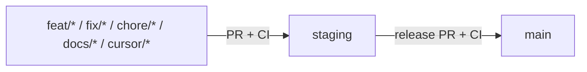

# Contributing to Maw3ed

English guide for humans and AI agents. The only supported push path is:

**feature branch → PR into `staging` (CI green) → release PR `staging` → `main`**

Direct pushes to `main` / `staging` are blocked by GitHub branch protection **and** local git hooks (once enabled).

> App environments remain **`local`** and **`production` only**. See [`docs/ENVIRONMENTS.md`](docs/ENVIRONMENTS.md). The Git branch named `staging` is not an application mode; do not confuse it with `npm run check:staging`.

## Flow diagram



## Quick start (do it right in one command)

```bash
# 1) Install deps (also enables versioned hooks via prepare)
npm install

# 2) Start a branch from latest staging
npm run git:new-branch -- feat/my-change

# 3) Commit (Conventional Commits enforced by commit-msg hook)
git commit -m "feat: my change"

# 4) Open PR into staging
npm run git:open-pr
# or: npm run git:open-pr -- "feat: my change"
```

**Windows PowerShell 5.1**

```powershell
cd E:\UpNexa.com\maw3ed
npm install
powershell -NoProfile -ExecutionPolicy Bypass -File scripts\git\new-branch.ps1 -Name feat/my-change
# ... commits ...
powershell -NoProfile -ExecutionPolicy Bypass -File scripts\git\open-pr.ps1 -Title "feat: my change"
```

**Git Bash (Windows) / macOS / Linux** — same `npm` / `bash scripts/git/*.sh` commands as above.

### Helper `-B` risk

`git:new-branch` / `new-branch.ps1` use `git checkout -B <name> origin/staging`. That **resets an existing local branch** of the same name to `origin/staging`. Use the helper only for a **genuinely new unique** name. For an existing feature branch, use `git switch <name>` and merge `origin/staging` (see Arabic guide).

## Branch rules

| Target (`base`) | Allowed head | Notes |
| --- | --- | --- |
| `staging` | `feat/*`, `fix/*`, `chore/*`, `docs/*`, `feature/*`, `hotfix/*`, `refactor/*`, `test/*`, `ci/*`, `build/*`, `perf/*`, `style/*`, `cursor/*`, `sync/*`, `dependabot/*` | Day-to-day work |
| `main` | **`staging` only** | Release PR |

PR titles must follow [Conventional Commits](https://www.conventionalcommits.org/), e.g. `feat: add X`, `fix(ui): correct Y`. Release PRs may also use `Release: …`.

## Enforcement layers

1. **GitHub branch protection** — no direct push; required checks; strict up-to-date; enforce admins.
2. **GitHub Actions `branch-flow`** — fails illegal PRs (wrong base/head/title). Stable check name: **`branch-flow`**.
3. **Local hooks** (`.githooks/`, `core.hooksPath`) — `pre-push` blocks pushes to `main`/`staging` and bad branch names; `commit-msg` requires Conventional Commits (allows subjects starting with `Merge ` / `Revert `).
4. **Helpers** — `git:new-branch` / `git:open-pr` always base on / target `staging`.

Enable hooks manually if needed:

```bash
npm run git:setup-hooks
# or: bash scripts/git/setup-hooks.sh
# or: powershell -File scripts\git\setup-hooks.ps1
```

## CI checks

| Check name | Role |
| --- | --- |
| **`quality`** | `npm ci` + JS syntax check (required-check candidate; no secrets/DB) |
| **`branch-flow`** | PR lane/name/title guard — **add as a required status check** |

Integration/smoke suites (`test:smoke`, `test:all`, `check:staging`, …) stay local / host-side; they are not required GitHub checks.

## Package manager

Scripts and docs use **npm** (`package-lock.json`). The repo may also contain `pnpm-lock.yaml` / `yarn.lock` for historical tooling; do not casually delete lockfiles. Prefer `npm install` / `npm ci` unless you intentionally use the multi-manager refresh helpers.

## Troubleshooting

### Protected branch rejection / “direct push” denied

You tried to push `main` or `staging`. Create a feature branch and open a PR:

```bash
npm run git:new-branch -- feat/my-fix
npm run git:open-pr
```

### `branch-flow` CI fails: PR into main from non-staging

Only `staging` → `main` is allowed. Merge your feature PR into `staging` first, then open the release PR.

### `branch-flow` CI fails: bad branch name

Rename / recreate with an allowed prefix (`feat/…`, `fix/…`, …) from latest `staging`.

### `gh` / push: needs Write permission / wrong account / token scopes

1. Check identity: `gh auth status` and `git remote -v`.
2. Classic personal access token needs the **`repo`** scope.
3. Fine-grained token needs **Contents** + **Pull requests** (read and write) on **this** repository.
4. Re-login: `gh auth login` and pick the account that has Write on `HFakhry81/maw3ed`.

### Hooks not running

```bash
git config --get core.hooksPath   # expect: .githooks
npm run git:setup-hooks
```

On Windows, Git runs hook scripts with its bundled Bash — install Git for Windows if hooks are skipped.

### Commit rejected by `commit-msg`

Use Conventional Commits: `feat: …`, `fix: …`, `chore: …`. Merge and `Revert` subjects are allowed.

## Docs

- [`docs/GIT_WORKFLOW.md`](docs/GIT_WORKFLOW.md) — short English lane summary
- [`docs/GIT-WORKFLOW-AR.md`](docs/GIT-WORKFLOW-AR.md) — Egyptian Arabic practical guide
- [`docs/LOCAL_CURSOR_WORKFLOW.md`](docs/LOCAL_CURSOR_WORKFLOW.md) — local Cursor Desktop flow
- [`AGENTS.md`](AGENTS.md) — agent-oriented project map
