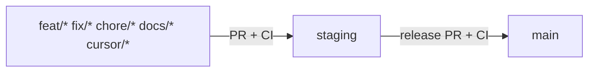

# Git workflow — feature → staging → main

Maw3ed uses a three-lane Git flow (same spirit as Sam-Harness). Both **`staging`** and **`main`** are protected Git branches; local hooks and the **`branch-flow`** CI check reinforce the same rules.

**Full guide:** [`CONTRIBUTING.md`](../CONTRIBUTING.md) · **Arabic (practical):** [`GIT-WORKFLOW-AR.md`](./GIT-WORKFLOW-AR.md) · **Local Cursor:** [`LOCAL_CURSOR_WORKFLOW.md`](./LOCAL_CURSOR_WORKFLOW.md)

> **Not an app environment.** Official runtimes stay **`local`** and **`production` only** ([`ENVIRONMENTS.md`](./ENVIRONMENTS.md)). The Git branch `staging` is an integration lane. `npm run check:staging` is a production-like acceptance check, not this branch.



## Lanes

| Branch | Role |
| --- | --- |
| `feat/*`, `fix/*`, `chore/*`, `docs/*`, `cursor/*`, … | Day-to-day work. Branch **from `staging`**. |
| `staging` | Integration / pre-release. All feature PRs land here first. |
| `main` | Production / release. Updated only via a release PR from `staging`. |

## Day-to-day

```bash
npm run git:new-branch -- feat/short-name
# ... work + conventional commits ...
npm run git:open-pr
```

1. Update from staging via the helper (or `git fetch origin staging`).
2. Open a **PR into `staging`** (not `main`).
3. **CI must pass**: **`quality`** and **`branch-flow`**.
4. Merge into `staging` only after review + green CI.

## Application-independent automation

Any editor or application that can run a project command can invoke the repository flow:

```bash
npm run git:setup-hooks
npm run git:flow -- --message "fix: correct booking flow"
```

`git:flow` starts from the latest `staging` when invoked on `main` or `staging`, or continues on a valid feature branch. It stages changed files except environment/credential files, `data/`, generated `dist/`, uploads, backups, and dependency folders; scans the staged diff for common credential formats; runs the syntax check; then commits and pushes only the feature branch. It opens the feature PR to `staging` followed by a release PR to `main`.

The command waits for required checks and never bypasses GitHub protections. When a required review is still pending, it requests GitHub auto-merge and stops; rerun the command after that PR merges to resume the release flow. Local commits ahead of a protected remote branch cause a refusal. Local `main`/`staging` refs are fast-forwarded only when safe. After both PRs merge, it deletes this run's remote feature branch and removes the local feature branch only if the worktree is clean and Git confirms it is merged into `staging`.

Requires Git, Node.js, GitHub CLI (`gh`), and authenticated GitHub CLI access. Preview the intended flow without changing branches or files:

```bash
npm run git:flow -- --message "fix: correct booking flow" --dry-run
```

## Release

1. Open a **release PR: `staging` → `main`**.
2. CI runs again (`quality` + `branch-flow`).
3. Merge into `main` only after review + green CI.
4. Deploy from `main` per [`DEPLOY_VPS.md`](./DEPLOY_VPS.md).

`main` and `staging` SHAs need not be identical after a release merge commit.

## CI triggers

- `.github/workflows/ci.yml` — push/PR to `main` or `staging` (job name **`quality`**).
- `.github/workflows/branch-flow.yml` — PRs to `main` or `staging` (job name **`branch-flow`**).

`quality` runs `npm ci` + syntax check only (no Postgres/secrets/smoke). Broader smokes stay local (`npm run test:smoke`, `test:all`, `check:staging`).

## Protections (owner)

Configure GitHub branch protection / rulesets on **`staging`** and **`main`**:

- Require a pull request before merging
- Require status checks: **`branch-flow`**, **`quality`**
- Require branches to be up to date; enforce for administrators
- Disallow force pushes and deletions

Feature branches are not protected.
