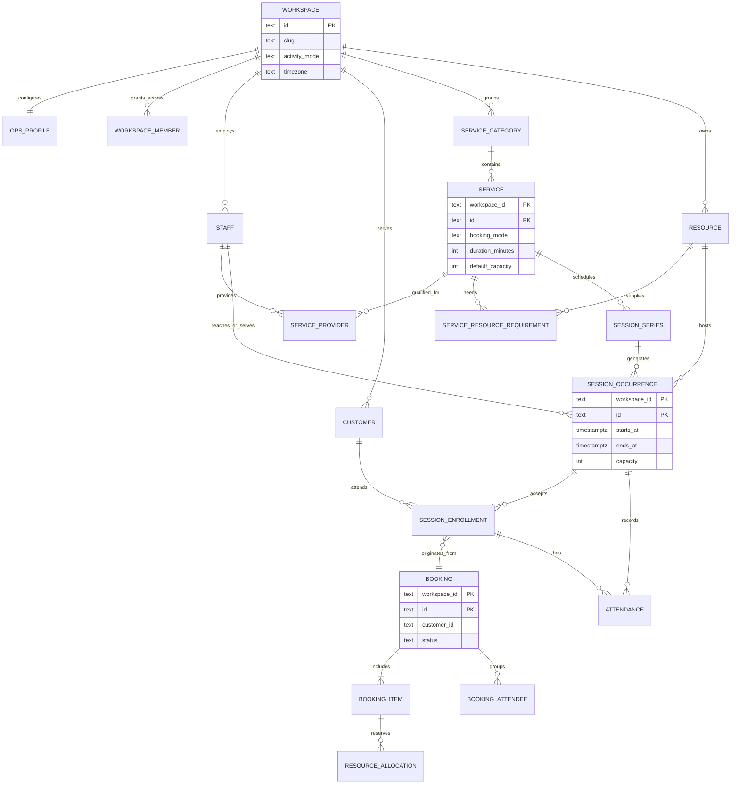

# نموذج مساحة العمل والسعة والحجز لمركز طلائع والأنشطة المختلفة

**تاريخ المراجعة:** 2026-10-26  
**الملف المدخل:** `C:\Users\Sam\Downloads\code_artifact.md` — وصف تنظيمي وتشغيلي لمركز طلائع التعليمي.  
**مرجع التنفيذ:** migrations حتى `010_normalized_workspace_ops.sql`، `workspaceOpsPg.js`، `opsWorkspace.js`، `opsStore.js`، ونموذج المنتج الحالي.  
**الهدف:** بيان ما يمكن تمثيله في الهيكل الحالي، وما يلزم إضافته حتى تخدم Maw3ed الطب والتعليم والحلاقة والألعاب الرياضية دون فرض قاعدة حجز واحدة على أنشطة مختلفة.

## الخلاصة

مساحة العمل يجب أن تمثل **مؤسسة العميل وبياناتها وحدودها وصلاحياتها**. نوع النشاط (`education`, `medical`, `salon`, `billiards`, `fitness`) يختار المصطلحات والشاشات والميزات الافتراضية، لكنه لا ينبغي أن يغيّر قاعدة ملكية البيانات أو يسمح بخلط بيانات المؤسسات.

قاعدة الحجز ليست واحدة لكل نشاط:

1. **حجز حصري لمورد أو مقدم خدمة:** الموعد يشغل طبيباً/كرسياً/طاولة واحدة في فترة زمنية، ولا يقبل تعارضاً آخر على المورد نفسه.
2. **جلسة جماعية محددة السعة:** للحصة موعد واحد مشترك يمكن أن يسجل فيه حتى 50 أو 100 طالب؛ الحجز يستهلك مقعداً أو أكثر من سعة الجلسة.
3. **حجز مركب بخدمات إضافية:** حجز رئيسي واحد يحتوي خدمات/بنوداً متتابعة مثل قص الشعر وصبغة وعناية. لكل بند مدته ومقدم الخدمة/المورد المطلوب، لكن العميل يرى حجزاً واحداً.

هذه الأنماط يجب أن تكون سياسات معلنة على الخدمة/الفعالية والموارد، وليست افتراضاً من اسم النشاط. يمكن لعيادة أن تقدم ورشة جماعية، ولمركز رياضي حصة جماعية وتدريباً فردياً، ولصالون حجزاً مركباً.

## 1. تحليل ملف مركز طلائع

### الهيكل والبيانات الواردة

- مؤسسة واحدة باسم **مركز طلائع التعليمي**، تعمل في مصر؛ الإعداد الأنسب مبدئياً `locale=ar` و`timezone=Africa/Cairo` و`currency=EGP` مع مراجعة العملة المطلوبة قبل إنشاء مساحة الإنتاج.
- أدوار تشغيلية: مدير المركز، علاقات عامة/تسويق، منسق أكاديمي، محاسب، وأربعة موظفي استقبال/إدارة.
- طاقم تعليمي مرتبط بمواد وصفوف ومراحل. المدرس نفسه قد يدرس أكثر من صف/مادة؛ لذلك علاقة المدرس بالخدمة/المادة متعددة إلى متعددة.
- هيكل تعليمي من مرحلة إعدادية وثانوية، وصفوف ومسارات (مثل علمي/أدبي) ومواد. هذه بيانات أكاديمية مترابطة، وليست مجرد أسماء خدمات مستقلة.
- أربع قاعات تعمل بالتوازي، وجدول حصص أسبوعي بفترات، مع سعة مطلوبة لكل حصة/قاعة (المثال الوارد 30–50، وطلب المستخدم يتضمن 50 أو 100).
- الطلاب يسجلون في حصة مشتركة. الحصة الواحدة لا تمثل موعد مريض واحداً؛ بل **جلسة واحدة لها مجموعة تسجيلات ومقاعد محدودة**.

### نقاط تحتاج قراراً من مالك المركز قبل إدخال بيانات نهائية

1. جدول المركز يقول إن ساعات تشغيل السبت–الخميس تنتهي 9 مساءً، بينما الفترة المسائية في الجدول تنتهي 9:30 مساءً. يجب تحديد وقت إغلاق المركز الفعلي أو تعديل موعد الفترة.
2. المركز موصوف بأنه يعمل ستة أيام السبت–الخميس، لكن الجمعة تتضمن صيانة 10 صباحاً–2 ظهراً وورش/اختبارات 4–8 مساءً. يجب تحديد أن الجمعة دوام فعال بموظفي استقبال محددين أم تشغيل استثنائي، ومن يغطي 7–8 مساءً.
3. لا توجد سعة فعلية لكل قاعة ولا توزيع صريح للحصص الأربع على القاعات. لا يمكن اعتماد سعة 100 قبل مطابقتها مع القاعة الفعلية والسعة المسموح بها.
4. لا يظهر جدول تفصيلي لتوفر كل مدرس على مدار الأسبوع أو فترات انتقاله بين القاعات. يجب إدخال توفر المدرس واختبار عدم جدولة مدرس أو قاعة في حصتين متداخلتين.
5. الملف لا يحدد الفصل الدراسي، سياسة التسجيل (لكل حصة أم اشتراك للمقرر/الفصل)، الإلغاء والاسترداد، رسوم المقعد، أو من يمكنه الحجز (ولي أمر/طالب). هذه قرارات منتج وتشغيل وليست حقولاً يمكن استنتاجها من المخطط وحده.

## 2. ما يدعمه الكود الحالي بالفعل

### بنية مساحة العمل

- `workspaces` و`workspace_members` يقدمان أساس مساحة عمل وعضوية/دور، وإن كان تنفيذ الصلاحيات على جميع عمليات التشغيل بحاجة لاستكمال وفق تقرير الجاهزية.
- migration 010 تنشئ `workspace_ops_profiles` بعلاقة واحد لواحد مع workspace، وتحتفظ بـ slug واسم المؤسسة والمنطقة الزمنية و`activity_mode` و`activity_template_id` والخطة وإعدادات التشغيل.
- `activity_templates` تتضمن قوالب مثل التعليم والطب والبلياردو والصالون والرياضة، وتسميات واجهة للنشاط. القالب الحالي يغير التسميات والإعدادات الأولية؛ لا يمثل وحده قواعد الحجز والسعة المتخصصة.
- في مساحات PostgreSQL الموجودة في `workspaces`، يقوم `opsWorkspace.runWithWorkspaceAsync` بتحميل البيانات المطبعة عبر `workspaceOpsPg`، وحفظ التغييرات داخل معاملة وقفل advisory على workspace. تبقى هناك مسارات محلية/قديمة ونسخة JSON cache، لذلك لا تُعد التهيئة وحدها دليلاً على أن كل المسارات تعمل على مصدر بيانات واحد.

### جداول تشغيل موجودة في migration 010

- `workspace_ops_profiles`: ملف نشاط لكل workspace.
- `workspace_ops_customers`: ملف عميل/مريض/طالب عام، لكن لا توجد علاقة ولي أمر بعد.
- `workspace_ops_service_categories` و`workspace_ops_services`: تصنيفات وخدمات ومدد وسعر وbuffer.
- `workspace_ops_staff` و`workspace_ops_service_providers`: موظفون/مقدمون وعلاقة متعدد-إلى-متعدد بينهم وبين الخدمات.
- `workspace_ops_working_hours` و`workspace_ops_staff_working_hours` والإغلاقات: ساعات العمل العامة والفردية والاستثناءات.
- `workspace_ops_appointments`: سجل حجز واحد يحتوي حالياً `customer_id`, `staff_id`, `service_id`, تاريخ ووقت ومدة وحالة، ومعرّفاتها الأساسية مركبة بـ workspace.
- `workspace_ops_appointment_line_items`: بنود إضافية للحجز، وهي أساس مفيد لحجز الصالون المركب.
- `workspace_ops_appointment_visits` و`...visit_meta`: سجل أحداث الزيارة/الخدمة.
- `workspace_ops_medical_departments`: امتداد محدد للطب، ما يبين أن بعض تفاصيل الأنشطة قد تحتاج جداول مجال منفصلة.

### الفجوة المحددة بالنسبة لمركز طلائع

المخطط الحالي لا يحتوي على سعة قصوى للخدمة أو الحصة، ولا occurrence/session للجلسة المجدولة، ولا تسجيل/حضور طالب لكل جلسة. سجل `workspace_ops_appointments` مفرد العميل؛ لا يستطيع وحده تمثيل قائمة 50 طالباً للحصة نفسها أو إحصاء المقاعد بدقة.

كذلك لا توجد جداول موارد للقاعات أو ربط الحصة بقاعة/مدرس في occurrence محدد. وحقول `service_id` و`staff_id` و`customer_id` في جدول الموعد لا تحمل في migration 010 مفاتيح أجنبية مركبة إلى سجلاتها؛ بعض الجداول الأخرى لديها مفاتيح مركبة جيدة داخل workspace، مثل علاقة الخدمة بمقدم الخدمة. يلزم استكمال الاتساق للمسارات الجديدة.

وجود `multi_service_enabled` و`line_items` يدعم نقطة بداية لعرض بنود متعددة، لكنه لا يحدد زمن/مقدم/مورد كل بند ولا يفرض تعارضاً لكل بند عند تأكيد حجز مركب.

## 3. النموذج المقترح: نواة مشتركة + امتدادات حسب النشاط

### المبادئ

1. `workspace_id` موجود في كل سجل تشغيلي، ومفتاح/قيد المركب يمنع ربط سجل من منشأة أخرى.
2. لا تستعمل اسم المدرس أو الطبيب داخل اسم الخدمة كمفتاح علاقة. الخدمة/المادة كيان مستقل، وإسناد مقدم الخدمة علاقة منفصلة.
3. الحساب الذي يسجل الدخول (`app_user`) وعضويته (`workspace_member`) منفصلان عن ملف العامل (`staff`). يمكن للعامل تسجيل الدخول عبر ربط اختياري بين ملفه وحساب العضوية.
4. مقدم الخدمة أو المورد القابل للحجز مفهوم منفصل عن موظف الاستقبال/المحاسب. مناوبة الموظف لا تعني تلقائياً أنه مورد يمكن حجزه.
5. سجلات المجال المشتركة للحجز والمال والإشعار تبقى موحدة؛ تفاصيل التعليم/الطب/الصالون تكون امتدادات ذات قيود واضحة، لا أعمدة غامضة تتغير حسب التسمية.
6. يحفظ الزمن الفعلي كـ `timestamptz`/فترة زمنية، وتخزن المنطقة الزمنية على workspace أو الموقع. تعرض التواريخ بالتوقيت المحلي للمؤسسة.

### مخطط علاقات منطقي

المخطط توضيحي للحدود والعلاقات، وليس SQL migration جاهزاً. يجب أن تحمل الجداول ذات المفاتيح الخارجية `workspace_id` في طرفي العلاقة، وأن تشير المفاتيح إلى `(workspace_id, id)`.

### الكيانات المقترحة

| الكيان | الغرض والعلاقات الرئيسية |
|---|---|
| `workspaces` / `workspace_members` | ملكية المنشأة، المستخدمون، أدوار الوصول. إعداد طلائع: Workspace باسم مركز طلائع التعليمي ونشاط `education`. |
| `workspace_ops_profiles` | الإعدادات العامة، locale/timezone/currency، slug والقالب. لا تخزن فيه قائمة الطلاب أو الجداول الأسبوعية. |
| `staff` + `workspace_member_staff` (أو user_id اختياري) | ملف المدرس/الموظف، مع ربط حساب دخول اختياري. الأدوار الدقيقة تمنح عبر العضوية/الصلاحيات، لا من لقب الموظف فقط. |
| `service_categories` / `services` / `service_providers` | مفاهيم عامة: تصنيف، خدمة قابلة للعرض/الحجز، ومقدموها. أمثلة التعليم: المرحلة/الصف/المادة؛ لا يكرر المدرس في الاسم. |
| `resources` | قاعة، غرفة علاج، كرسي، طاولة بلياردو، جهاز PlayStation، ملعب/جهاز. تحفظ السعة ونوع المورد والموقع والحالة. |
| `service_resource_requirements` | يحدد هل الخدمة تحتاج مورداً بعينه أو نوعاً/عدداً من الموارد. الحجز يثبت المورد الفعلي في وقت محدد. |
| `session_series` | قاعدة تكرار لمقرر/حصة أو مجموعة/حصة رياضية: الخدمة، المدرس، أيام الأسبوع، وقت البداية والنهاية، نافذة التكرار، والمنطقة الزمنية. |
| `session_occurrences` | نسخة فعلية لكل تاريخ: البداية والنهاية، القاعة/المورد، مقدم الخدمة، السعة الفعلية، والحالة. الإلغاء أو تغيير يوم لا يغير السلسلة كلها. |
| `customers` / `customer_relationships` | ملف الطالب أو العميل. إضافة صلة ولي أمر/تابع حتى يستطيع ولي الأمر حجز عدة أبناء؛ لا تخلط حساب ولي الأمر بملف كل طالب. |
| `bookings` / `booking_items` / `booking_attendees` | حجز واحد ظاهر للعميل، يحتوي بنداً واحداً أو عدة خدمات، وأسماء المستفيدين عند الحاجة. يحتفظ بمفتاح idempotency وحالة وتدقيق. |
| `session_enrollments` | تسجيل طالب/عميل في occurrence أو مجموعة مقرر، مع عدد المقاعد والحالة والحجز المصدر. هذا هو مصدر حساب سعة الحصة. |
| `attendance_records` | حضور/غياب/تأخير/عذر لكل طالب في كل occurrence؛ unique على `(workspace_id, occurrence_id, enrollment_id)`. |
| `resource_allocations` | الفترة التي يستهلكها كل بند حجز من مدرس/غرفة/كرسي/طاولة؛ تمنع التداخل في الموارد الحصرية. |
| `appointment_line_items` | خدمات إضافية في حجز واحد؛ يجب إضافة مدة/سعر/مقدم/مورد/ترتيب لكل بند عند تنفيذ الحجز المركب. |

## 4. كيف يسجل مركز طلائع في هذا النموذج

### إعداد مساحة العمل

1. ينشئ حساب المالك مساحة `مركز طلائع التعليمي` في `workspaces`، ويضاف كـ owner في `workspace_members`.
2. ينشأ `workspace_ops_profiles` مرتبطاً بالـ workspace: `activity_mode=education`, `activity_template_id=education`, اللغة العربية، المنطقة الزمنية `Africa/Cairo`، والعملة التي يعتمدها المركز.
3. تنشأ صلاحيات مدير، منسق أكاديمي، محاسب، تسويق، واستقبال داخل هذه المساحة. توزع أقل الصلاحيات المطلوبة: المنسق يدير المقررات والجداول، المحاسب القيود المالية، والاستقبال عمليات التسجيل والحضور؛ لا تكفي أدوار عامة مثل `staff` إن لم يحدد backend صلاحياتها.
4. ينشأ ملف staff واحد لكل مدرس، حتى إذا كان يدرس عدة صفوف؛ تربط الخدمة/المقرر بالمدرس عبر علاقة متعدد لمتعدد.
5. تنشأ ملفات للموظفين الإداريين، لكن لا يظهرون ضمن `service_providers` ولا يحجزهم الطلاب. تحفظ مناوبات استقبالهم كجداول دوام تشغيلية/HR منفصلة عن وقت توفر المدرس للحصص.

### المرحلة والصف والشعبة والمادة

- `education_programs`: المرحلة (إعدادي/ثانوي/بكالوريا) والصف أو المستوى.
- `education_tracks`: شعبة اختيارية (علمي علوم، علمي رياضة، أدبي)؛ الصفوف المشتركة لا تحتاج track.
- `education_subjects`: تعريف موحد للمادة (رياضيات، علوم، لغة عربية...).
- `education_offerings` أو Course Offering: مقرر بعينه في الفصل الدراسي لصف/شعبة محددة، ويرتبط بالخدمة المشتركة ومجموعة الطلاب. مثال منطقي: مادة رياضيات + أولى إعدادي + ترم محدد.
- `session_series`: يحدد اليوم/الفترة/مدرساً ومجموعة/سلسلة الحصص، ثم يولد `session_occurrences` لكل تاريخ.
- `resources`: أربع قاعات مبدئياً، مع إدخال السعة الحقيقية لكل قاعة. يربط occurrence بقاعة واحدة على الأقل؛ يسمح بأكثر من قاعة للمحاضرة فقط إذا كان ذلك مدعوماً عمداً.
- `session_enrollments`: الطالب يسجل في المجموعة أو جلسة واحدة حسب سياسة البيع؛ يعرض النظام المقاعد المتبقية ويغلق التسجيل عند بلوغ أصغر حد من سعة الشعبة والقاعة وسياسة الخطة.
- `attendance_records`: يفتح سجل الحضور للمسجلين في تلك الحصة؛ QR يحدد تسجيل الطالب/الجلسة بعد التحقق، ولا يكشف بيانات طالب آخر.

**توصية التشغيل لطلائع:** إذا كانت الحصة تتكرر أسبوعياً ويشتري الطالب المقرر طوال الفصل، استخدم enrollment على مستوى المقرر/المجموعة مع حضور لكل occurrence؛ لا تطلب منه حجز مقعد جديد كل أسبوع. أما الاختبار الدوري أو الورشة المنفردة يوم الجمعة فتسجل على occurrence محدد بسعته المستقلة.

### قاعدة السعة

لجلسة occurrence سعتها `C`، فإن المقاعد المشغولة هي مجموع `seats` للتسجيلات النشطة التي حالتها `reserved/confirmed/attended` وفق سياسة التسجيل. المتاح = `C - occupied`; التسجيل الملغى أو المنتهي لا يشغل مقعداً بعد اعتماد الإلغاء.

عند محاولة التسجيل:

1. ابدأ transaction.
2. اقفل صف `session_occurrences` المحدد بـ `(workspace_id, id)` عبر `SELECT ... FOR UPDATE` أو آلية مكافئة؛ يجب أن يكون صف الجلسة موجوداً حتى تتسلسل كل محاولات تعديل سعته.
3. أعد حساب المقاعد النشطة بعد أخذ القفل.
4. تحقق من أهلية الطالب/المجموعة، عدم التسجيل المكرر، عدم تجاوز السعة، أهلية الحجز، وعدم تجاوز حدود الخطة.
5. أنشئ booking + attendee/enrollment + سجل تدقيق/إشعار outbox في المعاملة نفسها ثم commit.
6. أعد `409 SESSION_FULL` عند امتلاء المقاعد، و`409 ALREADY_ENROLLED` عند التكرار؛ لا تعتمد على فحص الواجهة فقط.

قفل الصف الموجود يجعل حجز المقاعد لنفس الجلسة متسلسلاً. الأقفال على صفوف حجوزات غير موجودة لا تمنع السباق؛ توثيق PostgreSQL يوضح أن `FOR UPDATE` يقفل الصفوف المعادة من الاستعلام، لذا قفل صف occurrence المركزي يضمن أن كل الطلبات تتنافس على هدف موجود. [PostgreSQL SELECT locking](https://www.postgresql.org/docs/current/sql-select.html).

## 5. أوضاع الحجز حسب طبيعة النشاط

| النشاط/الخدمة | `booking_mode` مقترح | ما يستهلكه الحجز | قاعدة منع التعارض |
|---|---|---|---|
| كشف طبيب/جلسة عيادة فردية | `exclusive` | طبيب + غرفة/مورد طبي + فترة | لا تداخل على أي مورد مطلوب؛ سعة مريض واحدة إلا إذا صممت الخدمة صراحةً جماعية. |
| ورشة/علاج جماعي بالمستشفى | `session_capacity` | مقاعد جلسة واحدة | التسجيل النشط لا يتجاوز `session.capacity` مع حضور مستقل لكل مريض/مشارك. |
| درس مدرسي أو مراجعة جماعية | `session_capacity` | مقعد طالب في مجموعة/تاريخ | حد الشعبة والقاعة؛ الطلاب المشتركون ينضمون لنفس occurrence. |
| حصة تدريب جماعية في ناد رياضي | `session_capacity` | مقعد مشترك، ومدرب/قاعة | السعة محدودة بمقاعد القاعة/الأجهزة والمدرب. |
| تدريب شخصي في النادي | `exclusive` | مدرب + جهاز/منطقة إذا لزم | لا تداخل لموارد التدريب المطلوبة. |
| حلاقة/تجميل بخدمة واحدة | `exclusive` | مقدم خدمة + كرسي/غرفة | فترة الخدمة والـ buffer تحجز الموارد. |
| صبغة + قص + عناية في زيارة واحدة | `bundle` كتركيب booking، مع قيود الموارد لكل line item | حجز parent واحد، بنود متعددة بزمن/مقدم/مورد | يحسب كل بند في جدوله؛ تسمح بالعمل المتوازي فقط إذا الموارد المختلفة متاحة. |
| استئجار طاولة بلياردو/جهاز PlayStation | `rental` | طاولة/جهاز واحد لمدة يختارها العميل | حجز المورد حصرياً للفترة؛ المجموعة المرافقة لا تستهلك موارد إضافية إلا إذا كانت السعة محددة. |
| صالة ألعاب/ملعب يتسع لعدة لاعبين | `session_capacity` أو `rental` حسب طريقة التشغيل | مقاعد جلسة أو مورد خاص | سياسة واضحة: يحجز العميل المجموعة كاملة أم يشتري كل فرد مقعداً. |

الـ add-ons ليست نمط سعة رابعاً؛ إنها **مجموعة booking items تحت حجز واحد**. قد تكون خدمة الصالون نفسها `exclusive`، ثم يضيف المستخدم خدمات أخرى على booking parent.

### الفرق بين وضع الحصة الجماعية والحجز المركب

- رياضيات الساعة 5:00 وعدد الطلاب 50: occurrence واحدة وطلاب كثيرون في تسجيلات مستقلة؛ لا تنشأ 50 فترة زمنية منفصلة ولا تمنع تسجيل الطالب الثاني بسبب تعارض وقت المدرس.
- موعد تجميل الساعة 5:00 مع قص وصبغة وعناية: booking واحد وعميل واحد، لكن line items تشغل مقدمين/موارد خلال فترة. يجب منع تداخل أي بند مع حجز آخر على المورد نفسه.
- الطبيب الساعة 5:00: booking فردي واحد للمورد. طبيب آخر في الوقت نفسه يسمح به إذا كان مورداً مختلفاً.

## 6. قواعد سلامة قاعدة البيانات

- مفاتيح فريدة مركبة مثل `(workspace_id, id)`، ومفاتيح أجنبية مركبة إلى الكيانات التابعة للمساحة نفسها.
- unique يمنع تكرار التسجيل النشط للطالب في المجموعة/الحصة نفسها حسب السياسة.
- capacity لا يكفي لها `CHECK` على الصفوف؛ تحقق العدد يحتاج transaction + قفل occurrence أو counter ذري مع اختبار منافسة. لا تسمح بتجاوز الحد عبر تسجيلين متزامنين.
- في الحجز الحصري، استخدم فترة زمنية كاملة `[start, end + buffer)` وقيود عدم تداخل/قفل موارد. PostgreSQL يدعم exclusion constraints على range types لمنع تداخل الفترات؛ يجب تكييفها مع دعم `btree_gist` لمعرف المورد وحالات الحجز النشطة. [PostgreSQL range constraints](https://www.postgresql.org/docs/current/rangetypes.html#RANGETYPES-CONSTRAINT) · [PostgreSQL exclusion constraints](https://www.postgresql.org/docs/current/ddl-constraints.html#DDL-CONSTRAINTS-EXCLUSION).
- حالة الحجز `cancelled/expired` لا تحتسب ضمن السعة أو تمنع المورد؛ انتقال الحالة يجب أن يحرر المقعد/المورد بذريّة.
- لكل عملية حجز مفتاح idempotency حتى إعادة المحاولة الشبكية لا تسجل الطالب أو تدفعه مرتين.
- إنشاء التسجيل، خصم المقعد، سجل الحضور/التدقيق، وتوليد إشعار outbox يجب أن تكون متسقة في معاملة واحدة.
- قيود السياسة لا تُشتق من `activity_mode` فقط؛ تتحكم بها خصائص الخدمة وoccurrence/resource، مع قوالب نشاط افتراضية قابلة للتعديل.

## 7. مقارنة صريحة مع الوضع الحالي

| المطلوب | الوضع الحالي في المستودع | القرار/الفجوة |
|---|---|---|
| Workspace باسم المؤسسة ونشاطها | `workspaces`, `workspace_members`, `workspace_ops_profiles`; قوالب activity تشمل education وغيرها | أساس مناسب لإنشاء مساحة طلائع؛ يلزم تفعيل صلاحيات backend لكل عضوية قبل التشغيل الفعلي. |
| أسماء وترجمة النشاط | `activity_templates`, labels, `activity_mode` | يغير العرض؛ لا يحدد هل الحجز حصري أم بسعة. أضف `booking_mode` صريحاً للخدمة/الجلسة. |
| الصف/المسار/المادة/الفصل | تصنيفات وخدمات عامة فقط؛ يوجد medical departments | أنشئ جداول امتداد تعليمية (program/track/subject/term/offering) أو mapping موثق بينها وبين services. |
| المعلم متعدد المواد والصفوف | `workspace_ops_service_providers` يدعم خدمة↔staff | استخدمه لإسناد التأهيل، وأضف إسناد المدرس/القاعة الفعلي لكل occurrence حتى لا تختلط أهلية التدريس بجدول الأسبوع. |
| القاعات والموارد | لا يوجد `workspace_ops_resources` في migration 010 | فجوة واضحة: أضف resources وسعتها وحجزها وعلاقتها بالموقع/الجلسة. |
| مجموعة من الطلاب في وقت واحد | appointment يحفظ customer واحداً، لا capacity أو enrollment | فجوة مانعة للتعليم الجماعي: أضف occurrences + enrollments/attendees + attendance. |
| خدمات متعددة لحجز واحد | line items موجودة ومحمولة من Postgres | أساس جزئي جيد، لكنه لا يحجز وقتاً/مقدماً/موردًا منفصلاً لكل بند. |
| دوام موظفي الاستقبال | جداول staff hours موجودة، لكن لا تعني صلاحيات/نوع الدوام | أضف ربط مستخدم/دور وميّز `work_shift` عن `provider_availability` كي لا يظهر الاستقبال كخدمة قابلة للحجز. |
| مفاتيح أجنبية tenant-safe | علاقات الخدمات/الفئات ومقدمي الخدمة مركبة في بعض الجداول | أكمل FKs المركبة للخدمة/الموظف/العميل من booking، وأضف RLS/تفويض مركزي كدفاع إضافي. |
| التخزين | `workspaceOpsPg` ينفذ load/save مطبعاً للمساحات المسجلة مع transaction advisory lock؛ يوجد أيضاً local JSON/legacy path | migration 010 خفّض فجوة التخزين السابقة؛ لا يزال يلزم تدقيق كل path، تقليل إعادة حفظ كامل workspace عند كل تغيير، وإيقاف المصدر القديم بعد migration موثق. |

**حكم هذا الطلب:** يمكن بدء تهيئة Workspace لمركز طلائع في البنية الحالية؛ لا يمكن تفعيل نموذج 50–100 طالب للحصة بأمان من الجداول الحالية وحدها. يلزم تنفيذ نموذج الجلسات والسعة والحضور والقاعات وتفويض المستخدمين أولاً.

## 8. مسار التنفيذ المقترح لهذه المواصفة

1. **تعريف سياسة البيع:** اختيار تسجيل في مقرر/فصل أم مقعد لكل جلسة؛ تعريف guest vs guardian، حد المقاعد، الرسوم والإلغاء.
2. **تثبيت النواة:** التحقق من workspace/member/auth؛ توحيد مسار PostgreSQL وعدم الاعتماد على workspace id من العميل.
3. **نموذج الموارد والحجز:** migration لجداول resources/resource requirements/session occurrences/enrollments/attendance، وإضافة `booking_mode` وقيود composite FK.
4. **محرك availability:** حساب جدول المدرس والقاعة والسعة للفترات والتغييرات والإجازات، بقاعدة timezone موحدة.
5. **تسجيل ذري:** endpoint للانضمام إلى المجموعة يحجز المقاعد transactionally مع idempotency، ورسائل انتظار/رفض عند الامتلاء.
6. **تهيئة طلائع:** إدخال الصفوف/المسارات/المواد والمدرسين والقاعات والجدول؛ التحقق من المدرس/القاعة/الفترة والسعة قبل النشر للعميل.
7. **الحضور والإشعارات:** تسجيل حضور لكل طالب، QR token محدود ومربوط بالجلسة/الطالب، وتذكير ولي الأمر حسب الموافقة.
8. **امتدادات الأنشطة الأخرى:** إعداد قوالب `medical`, `salon`, `billiards`, `fitness` لقيم `booking_mode` ومتطلبات الموارد؛ اختبارات سيناريو لكل نمط، لا اختبار واحد عام.
9. **بوابة قبول:** اختبارات cross-workspace، تجاوز السعة بطلبات متزامنة، عدم التداخل للمورد، الإلغاء وإعادة المقعد، حضور مكرر، حجز bundle بخدمات متداخلة، وترحيل/استعادة.

## 9. أمثلة اختبار قبول ملموسة

- سعة حصة 50: 50 تسجيلاً نشطاً ينجح، الـ51 يرفض. 10 طلبات متزامنة للمقاعد المتبقية عندما لا يوجد إلا 3 مقاعد: 3 فقط تنجح.
- الإلغاء: يلغي طالب مقعداً؛ يصبح المقعد متاحاً مرة واحدة، ولا يمكن لطلب retry مضاعف تحرير مقعدين.
- طالب مسجل في رياضيات لا يستطيع تسجيل نفسه مرتين في occurrence نفسها؛ يمكنه حضور مادة أخرى بنفس الوقت فقط إذا السياسة والموقع تسمحان.
- مدرس أو قاعة لا يمكن تخصيصهما لحصتين متداخلتين حتى لو كانت السعة المتبقية في الفصل متاحة.
- خدمة حلاقة مركبة: قص + صبغة يظهران كحجز واحد، ويحجز كل line الموارد والمدد؛ فشل أي مورد يعيد العملية كلها دون booking ناقص.
- صالون/عيادة/مركز تعليمي لا يستطيع قراءة أو تعديل بيانات مساحة أخرى بتغيير IDs أو headers.
- قاعة سعتها 30 وحصة configured capacity=50: النظام يرفض أو يخفض capacity الفعلية إلى 30؛ لا يستخدم الحد الأكبر بصمت.

## 10. المراجع التقنية

- PostgreSQL يقفل الصفوف التي يعيدها استعلام `FOR UPDATE` حتى نهاية المعاملة، وهو أساس قفل occurrence موجود عند ضبط السعة: [SELECT locking clause](https://www.postgresql.org/docs/current/sql-select.html).
- تتيح range types وexclusion constraints فرض عدم تداخل فترات الموارد الحصرية: [Range types constraints](https://www.postgresql.org/docs/current/rangetypes.html#RANGETYPES-CONSTRAINT) · [Exclusion constraints](https://www.postgresql.org/docs/current/ddl-constraints.html#DDL-CONSTRAINTS-EXCLUSION).
- شكل migration الحالي: [`010_normalized_workspace_ops.sql`](../db/migrations/010_normalized_workspace_ops.sql) وطبقة الـ mapping: [`workspaceOpsPg.js`](../workspaceOpsPg.js).

## ملاحظة إدراج البيانات

الملف المرفق يحتوي أسماء أشخاص وجداول عمل. هذا التقرير يحلل أنواع العلاقات المطلوبة ولا يكرر قائمة الأسماء؛ عند إدخالها إلى بيئة حقيقية، يجب مراجعة التفويض وموافقة أصحاب البيانات وعدم نسخها إلى بيئة عامة أو اختبار غير معتمدة.
